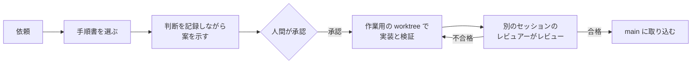
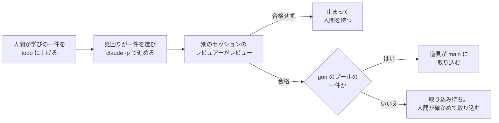
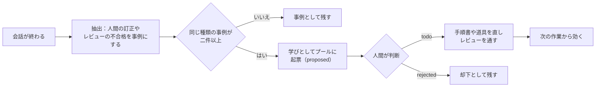
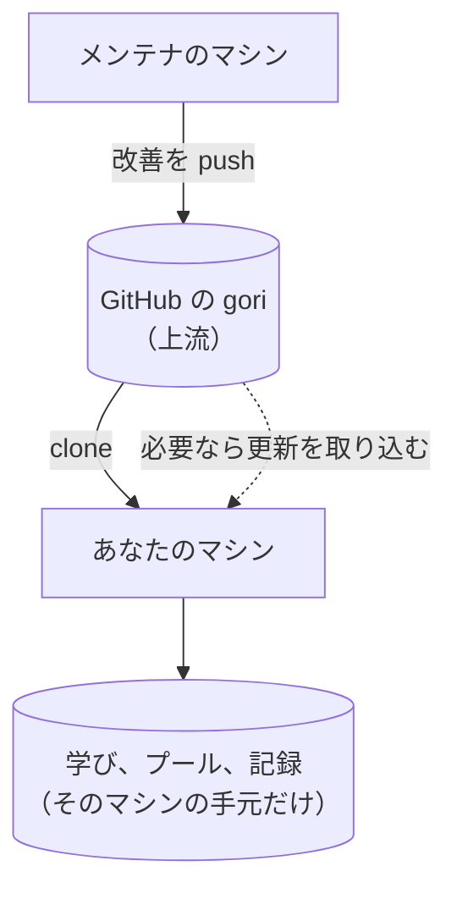

# gori

gori は、Claude Code で業務を進めるための汎用ハーネス（プラグイン）であり、作業の誤りから学び、手順と判断基準を自分で育てていく。
依頼ごとに手順書を選んで作業を進め、別のセッションのレビュアーが成果の合否を決め、会話の中で人間に訂正された誤りを学びとして溜める。
学びは人間が承認したものだけが手順書や道具に反映され、次の作業から効く。

## 二つのループ

gori は、作業を進める実行ループと、gori 自身を直す改善ループの二つで回る。

### 実行ループ：依頼を手順書で進め、レビューを通して取り込む



- 手順書は、依頼の種類（機能の実装、不具合の修正、調査、設計など）ごとに `knowledge/procedures/` にある。会話の始めに、手順書の索引が自動で読み込まれる。
- 判断基準は、規則の一行が索引に載り、会話の始めに毎回読み込まれる。仕組みと、上流から取り込むときに揃える部品は、`docs/design.md` の「判断基準の規則」にある。
- 作業の判断（手順を終えたか、飛ばしたか、受け入れ条件、人間の承認）は、判断の記録に一行ずつ残る。会話が途切れても、記録から再開できる。
- レビュアーは、成果を作ったのとは別のセッションで動き、書き込みを禁じたサンドボックスの中で、受け入れ条件を実物で確かめる。人間の承認が記録に無い作業は、レビューに出せない。

プールで `todo` に上げた学び（kind が learning の一件）は、人間が一件ずつ指さなくても、無人で進められる。improvement と procedure の一件は、無人では選ばれず、人間が会話で進める。



- 毎朝 `claude -n gori-auto "/gori:auto"` で窓口のセッションを立てる。窓口が見回り（`tools/auto/watch`）をバックグラウンドで走らせ、結果が出たら伝える。取り込みと再開は、窓口で頼む。窓口を閉じている間は、無人の作業は始まらない。
- `todo` に上げたことが、その一件の受け入れ条件の承認になる。無人の作業は、一件を `todo` や `done` にすること、承認を記録すること、main を動かすこと、push と PR の作成を、道具と git のフックに拒まれる。
- 無人で main に入るのは、gori のプールの学び（kind が learning の一件）だけである。取り込むのは作業者でなく道具で、取り込んだことは知らせない。push はしない。
- 費用は三つの層で抑える。ログインが claude.ai のサブスクリプションでなければ起動せず、一回の実行に時間と金額の上限を付け、一日に始める件数を限る。値は `knowledge/config/auto.md` にある。

### 改善ループ：誤りを学びにし、人間の承認を経て gori に反映する



- 抽出は、会話の終わりに一定の間隔で（既定値は `tools/hooks/session-end`）自動に起動する。手で起動することもできる。
- 抽出は事例と起票まで行い、gori の手順書や道具は書き換えない。直すのは、人間が `todo` に上げた後の作業である。
- 改善候補は、抽出のほか、作業の中で見つけたものも、同じプールに起票される。

## 上流と各マシン

gori は、マシンごとにチェックアウトを持ち、そのマシンで独自に育つ。



- 学び、改善候補のプール、作業の記録は、git の管理外の手元にだけ置かれ、どこにも送られない。
- 上流の更新は、手元で育てたものと上流を比べ、欲しいところだけを任意で取り込む。上流の履歴は畳まれることがあるので、merge で取り込む手順は無い。道具に origin を扱わせないなら、環境変数 `GORI_IGNORE_UPSTREAM=1` を設定する。
- 自分のマシンの改善を上流に戻す仕組みは無い。

## 導入

必要なもの：Claude Code、git、Node.js。

```
git clone https://github.com/hirotoni/gori.git
cd gori
tools/repo/install
```

`install` は、このチェックアウトを Claude Code のプラグイン `gori@gori` として登録し、git のフックの置き場所を設定する。
以後、どのリポジトリで Claude Code を使っても gori が読み込まれ、このチェックアウトがそのマシンの書き込み先になる。
チェックアウトを消すか移すと、gori は読み込まれなくなる。

## 使い方

ふだんどおり Claude Code に依頼する。gori が依頼に合う手順書を選び、案を示して承認を求める。
案の中身や問いに答え、進めてよければ承認する。

改善候補のプールは、端末から次のように扱う（`<gori>` は gori のチェックアウトの絶対パス）。

```
<gori>/tools/records/pool list                  起票された候補と着手を承認した候補の一覧
<gori>/tools/records/pool show <ID>             一件の全文
<gori>/tools/records/pool todo <ID>             着手を承認する
<gori>/tools/records/pool reject <ID> --why "<理由>"   却下する
```

`todo` と `reject` は、端末から実行するか、会話で Claude Code に頼んで実行させる。
`reject` を Claude Code の中から実行するときは、却下を頼んだ人間の発言を `--quote` に渡す。道具はそれを今の会話の最後の人間の発言と照らし、合わなければ拒む。無人の作業からは却下できない。

## 環境変数

利用者が変えうる環境変数は次の四つである。既定値と読み方は、それを読む道具のファイルにある。

- `GORI_SYSTEM_REPORT`：報告に gori 自身の仕組みの説明を含めるか（`tools/hooks/session-start`、規則は `config/routing`）。
- `GORI_EXTRACT_INTERVAL_HOURS`：学びの抽出を起動する間隔（`tools/hooks/session-end`）。
- `GORI_HOME`：状態とログの置き場所（`tools/lib/learning.mjs` の `goriHome`）。
- `GORI_IGNORE_UPSTREAM`：1 なら、上流（origin）を取り込まないマシンとして、main の取り込みと worktree の起点で origin を扱わない（`tools/repo/sync-main`、`tools/repo/worktree`）。

## データの置き場所

gori のチェックアウトの git の共通ディレクトリ（clone なら `.git`）の下の `gori/` に置く。どれも git の管理外である。
中身は `docs/design.md` の 2 章「記録」にある。

## リポジトリの構成

```
.claude-plugin/   プラグインの宣言
.prettierignore   knowledge/ を prettier の整形から外す（理由はファイルの注釈）
LICENSE           MIT ライセンスの全文
docs/             人間向けの文書（要件 harness-requirements.md、メンテナ向けの設計 design.md）
knowledge/        知識。実行ループが読み、改善ループが書く
  index.md        frontmatter から生成する索引。手で書かない
  procedures/     手順（参照キー procedures/<id>）
  criteria/       判断基準（criteria/<id>）
  skills/         能力（skills/<id>）
  agents/         役割（agents/<id>）
  config/         設定（config/<id>）
tools/            道具。扱う概念ごとに分ける
  package.json    拡張子なしの実行ファイルを ESM として読ませる
  lib/            道具が共有する部品
  hooks/          SessionStart（振り分けの注入）と SessionEnd（抽出待ちに積み、抽出を起動）
  knowledge/      知識ファイルの検査（lint）、索引の生成（build-index）、読み物への折り込み（show）
  records/        判断の記録（log）、作業の経過（trace）、レビュー結果（verdict）、レビュアーの起動（review）、使用の集計（usage）、改善候補のプール（pool）
  learning/       事例（case）、抽出の材料（sessions）、抽出の起動（extract-run）、効果の集計（metrics）
  pr/             GitHub の PR のレビュー（collect、check、pending）。submit は人間が行う
  auto/           無人の作業。kind が learning の todo の一件を一つ進める道具（run。improvement と procedure は選ばない。gori のプールの一件は、合格したら main に取り込む）、間隔を空けて run を呼ぶ見回り（watch）、人間の対応が要るものの一覧（status）、柵の git のフック（githooks）。フックは main を動かす操作と push を拒む
  repo/           導入（install）、作業 ID の worktree（worktree、prune-worktrees）、main の取り込み（sync-main）、履歴の畳み込み（squash-history。push はしない）、draft PR の作成（draft-pr。push はしない）、公開する中身の検査（check-public）、git のフック
tests/            道具のテスト。入口は tests/run.sh（全体）。--changed を付けると、main との分岐点から作業ツリーまでに変えたファイル（未追跡を含む）に関わるテストだけを走らせる（選び方は tests/lib/select.mjs）。lint と索引の検査はどちらでも走る
  e2e/            モデルや利用者の設定を要する、手動実行の検査。tests/run.sh には入れない
```

## 詳しい振る舞い

この文書は道具の振る舞いを書き写さない。正本は次のとおりである。

- 道具の引数、条件、出力：各道具のファイル（注釈と使い方の文）。
- 実行ループと改善ループの規則：`knowledge/` の知識ファイル。読み物には `tools/knowledge/show <参照キー>` を使う。
- 仕組みの細部と、そう決めた理由（gori を直す人向け）：`docs/design.md`。
- 個々のテストと E2E が何を確かめるか：各テストファイルの先頭の注釈。

## ライセンス

MIT ライセンスである。全文は `LICENSE` にある。
